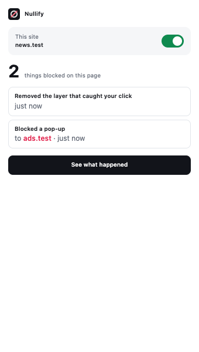
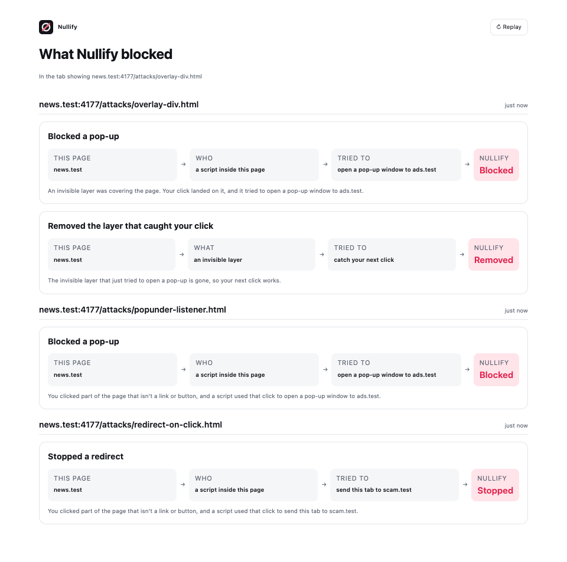

# Nullify

[](https://www.npmjs.com/package/@nullifyads/agent-guard) [](https://github.com/Aryavvij/nullify/actions/workflows/ci.yml) [](LICENSE)

**Stops click hijacking, for AI browser agents and for people.**

Pages can turn a click into something you didn't ask for. An invisible layer over a video player opens an ad tab. A transparent button stacked on "No thanks" clicks "Confirm" instead. A script sends your tab to another site. People fall for it, and AI agents that click by screen coordinates fall for it every time: they press whatever is on top, visible or not.

Nullify watches what a click actually does. A click either lands on what is visible, or Nullify refuses it and says why.

▶ **[66-second demo](docs/demo/nullify-demo.mp4)**, recorded from real runs.

## Results
From [NullBench](bench/README.md): 18 trap pages and 13 normal flows, run on local pages only.

| Who is clicking | Hijacked without Nullify | With Nullify | Normal flows still working |
|---|---|---|---|
| AI agent clicking coordinates (computer-use style) | 18/18 | **0/18** | 13/13 |
| AI agent sending raw input (browser-use style) | 17/17 | **0/17** | 13/13 |
| AI agent clicking elements (Playwright locators) | 9/18 (the rest time out with no reason) | **0/18**; covered targets are refused at once, with a reason | 13/13 |

Added time per click: about 0.7 ms for coordinate clicks; about 1.5 ms of checks for element clicks.

**For people, compared with uBlock Origin Lite** ([details](bench/README.md#comparison-with-ublock-origin-lite)): on ad domains no filter list knows yet, uBlock Origin Lite let 13/13 traps through and Nullify prevented 13/13. On known pop-under networks, uBlock Origin Lite blocked the ad's content but the tab still opened or the page was still replaced; Nullify prevented all 13. They do different jobs, and running both is the intended setup.

## Get it

**AI agents on Playwright (Node):**
```bash
npm install @nullifyads/agent-guard playwright-core
```
```ts
import { guard, NullifyBlockedError } from "@nullifyads/agent-guard";
const g = await guard(context);         // before navigating
await page.mouse.click(x, y);           // throws NullifyBlockedError if it would hit something invisible
const text = await g.visibleText(page); // page text without hidden instructions, for your model
```
Full API: [agent-guard/README.md](agent-guard/README.md)

**AI agents on Playwright (Python):** `pip install nullify-guard`. See [python/README.md](python/README.md).

**An MCP server with a protected browser** (e.g. for Claude Code): `claude mcp add nullify -- npx -y @nullifyads/mcp`. See [mcp/README.md](mcp/README.md).

**People (Chrome extension):** install from the Chrome Web Store once it's listed, or download the zip from the latest GitHub release and load it unpacked. The toolbar badge counts what was blocked, the popup explains it in plain words, and "See what happened" replays each block as a chain:

| Popup | Replay |
|---|---|
|  |  |

## How it works
- A small engine is injected into every page **before the page's own scripts run**. It holds onto the browser's original functions, so a page can't trick it by overriding them.
- **Intent check:** a pop-up or cross-site redirect is allowed only when the click landed on a visible control (link, button, form field, or something styled as clickable). A click on an invisible layer, plain text or a video isn't a request to go somewhere.
- **Every route covered:** `window.open`, programmatic and synthetic clicks on hidden links, `target=_blank` forms, `window.open` borrowed from a fresh iframe, same-tab redirects.
- **For agents:** each click is checked before it is sent and again inside the real pointer event, so nothing can slip in between. Invisible frames are made click-through, and refusals use only visible text.
- **Private:** everything runs locally. The extension makes no network requests and loads no remote code ([privacy policy](docs/store/PRIVACY.md)).

## What it doesn't do
- **It isn't an ad blocker.** It doesn't block ads, trackers or known-bad domains; use it alongside one.
- **It removes hidden prompt injection, not visible text** that tries to instruct a model.
- **Chromium only.**
- Known gaps are listed honestly in [PLAN.md](PLAN.md), and NullBench keeps them in its results.

## Repository
| Folder | What |
|---|---|
| `core/` | `@nullifyads/core`, the in-page engine |
| `agent-guard/` | `@nullifyads/agent-guard`, protection for Playwright agents |
| `python/` | `nullify-guard`, the same for Playwright-Python |
| `mcp/` | `@nullifyads/mcp`, the MCP server |
| `extension/` | Chrome extension (Manifest V3) |
| `bench/` | NullBench: trap pages, normal flows, test suites, results |
| `docs/` | Demo, screenshots, store listing, privacy policy, launch notes |

## Development
```bash
npm install
npx playwright install chromium
npm test              # build + unit, MCP and end-to-end tests
npm run test:python   # Python wrapper (needs uv)
npm run nullbench     # benchmark -> bench/results/latest.md
```
Load the extension unpacked from `extension/dist` after `npm run build`. Release steps: [docs/launch/RELEASE.md](docs/launch/RELEASE.md).

## License
MIT © 2026 Aryavvij
